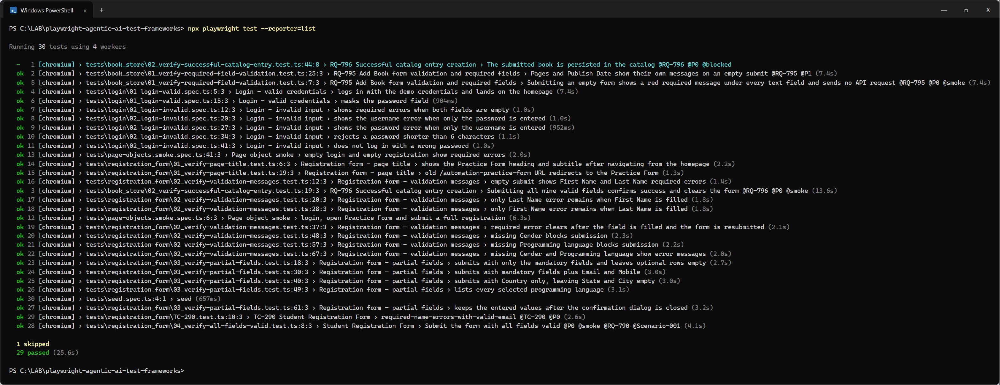
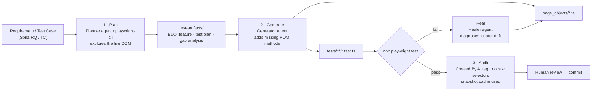
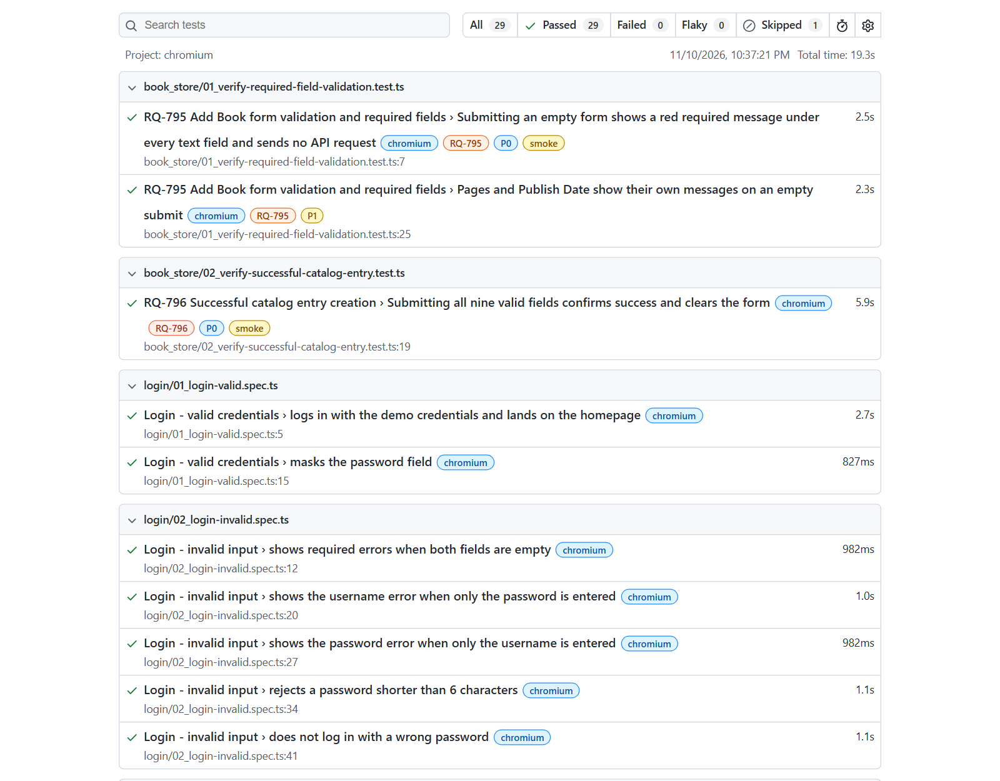
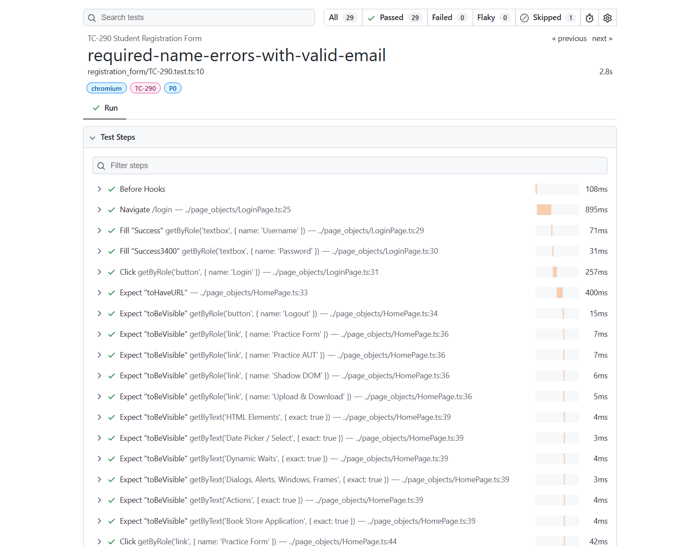
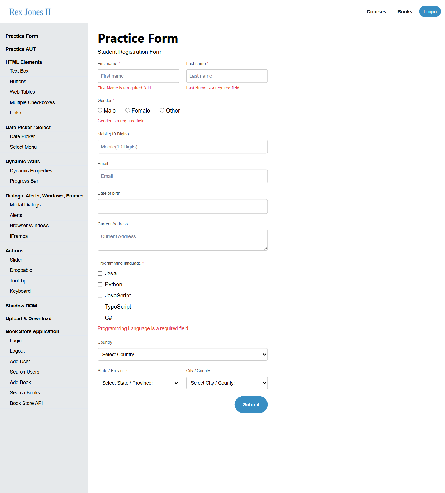
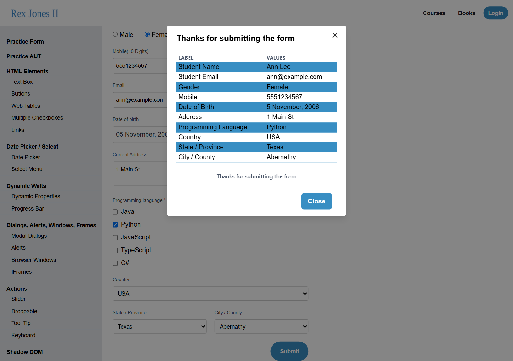
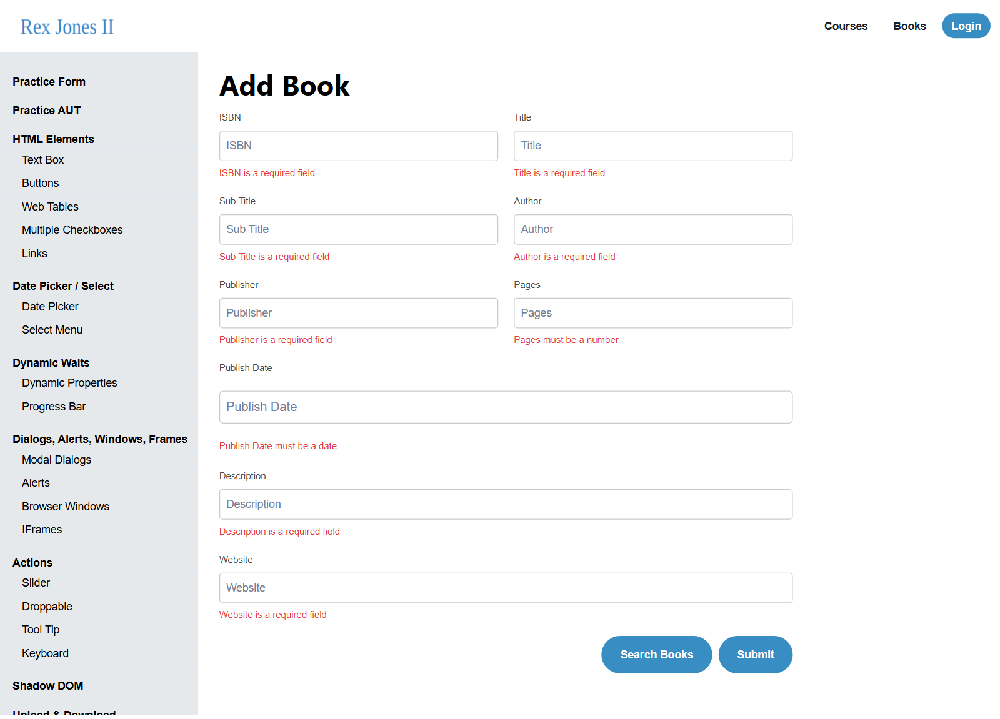

# Playwright Agentic AI Test Framework

[](https://github.com/ViktorVakareev/playwright-agentic-ai-test-frameworks/actions/workflows/playwright.yml)


An end-to-end **Playwright + TypeScript** test framework built with **agentic AI**: requirements go in, AI agents
explore the live application, write BDD test plans and gap analyses, generate Page Object Model tests, heal broken
locators, and audit their own output — with a human reviewing every step before it is pushed.

> Built while following the *Playwright & Agentic AI* material by **Rex Jones II** (Test Automation University).
> The application under test is his public practice site, **https://ui.rexjones2.com**. All code, plans and
> findings in this repo are my own work produced with AI assistance.



---

## Contents
- [How it works](#how-it-works)
- [What was built, step by step](#what-was-built-step-by-step)
- [Features](#features)
- [Quick start](#quick-start)
- [Running tests](#running-tests)
- [Test inventory](#test-inventory)
- [Defects and gaps found in the application](#defects-and-gaps-found-in-the-application)
- [Project structure](#project-structure)
- [AI accountability conventions](#ai-accountability-conventions)
- [Configuration](#configuration)
- [Lessons learned](#lessons-learned)
- [Limitations](#limitations)
- [Credits and license](#credits-and-license)

---

## How it works



The repo contains two ways of running this pipeline:

| Approach | Where | Used for |
|---|---|---|
| **Playwright Test agents** (Planner, Generator, Healer) driven through the Playwright Test MCP server | [`.github/agents/`](.github/agents/) · [`.vscode/mcp.json`](.vscode/mcp.json) | RQ-790 strategy, Scenario-001 generation, locator healing |
| **`playwright-cli` + skill** — token-efficient, snapshots saved to disk instead of streamed into the model's context | [`.claude/skills/playwright-cli/`](.claude/skills/playwright-cli/) | TC-290 spec-driven workflow, RQ-795/796 assembly line |
| **Assembly-line coordinator** — one agent that chains Plan → Generate (with a heal gate) → Audit | [`.github/agents/assembly-line-request-.agent.md`](.github/agents/assembly-line-request-.agent.md) | RQ-795 and RQ-796 |

---

## What was built, step by step

Each stage is a separate commit, so the history reads as a walkthrough.

| # | Exercise | Result | Where it lives |
|---|---|---|---|
| 1 | Connect AI tools: Playwright MCP and an Inflectra Spira MCP server | Both servers configured; the Spira API key is prompted for, never stored | [`.vscode/mcp.json`](.vscode/mcp.json) |
| 2 | **Planner**: analyse requirement **RQ-790** (Student Registration Form) against the live DOM | Test strategy with 14 requirement gaps, 16 PO/BA questions and a P0/P1/P2 regression structure; 34 numbered Gherkin scenarios | [`RQ-790-test-strategy.md`](test-artifacts/RQ-790-test-strategy.md) · [`RQ-790-student-registration.feature`](test-artifacts/RQ-790-student-registration.feature) |
| 3 | Build the **Page Object Model** | `LoginPage`, `RegistrationPage` (later `HomePage`, `AddBookPage`) | [`page_objects/`](page_objects/) |
| 4 | Create the test folders (`login/`, `registration_form/`) | 21 tests; first run surfaced a real behaviour (errors clear only on resubmit) | [`tests/login/`](tests/login/) · [`tests/registration_form/`](tests/registration_form/) |
| 5 | **Generator**: automate P0 **Scenario-001** using only POM methods | Added calendar date-picking to the POM; `// Created By AI` on line 1 | [`04_verify-all-fields-valid.test.ts`](tests/registration_form/04_verify-all-fields-valid.test.ts) |
| 6 | **Healer**: two locators were broken on purpose (`#emails`, `'Submitd'`) | Healer annotated both with the exact DOM difference *without* touching the code (guardrail), found the second, hidden failure, then applied the fix on request | commits `3f82f4e` → `72b6bbb` → `84e9579` |
| 7 | **playwright-cli** spec-driven workflow for test case **TC-290** | Plan with a core workflow + 9 gaps + 10 negative scenarios; one focused test, actions *and* assertions through POM methods | [`TC-290-plan.md`](test-artifacts/TC-290-plan.md) · [`TC-290.test.ts`](tests/registration_form/TC-290.test.ts) |
| 8 | **Assembly line** for **RQ-795** + **RQ-796** (Book Store "Add Book") | Plan → generate → heal (2 fixes) → audit; found a false-success defect and a time-zone bug | [`book_store/`](tests/book_store/) · [`RQ-795…feature`](test-artifacts/RQ-795-add-book-validation.feature) · [`RQ-796…feature`](test-artifacts/RQ-796-add-book-success.feature) |

---

## Features

- **Page Object Model, strictly enforced** — specs call POM methods only; no CSS/XPath in test files. Newer specs (TC-290, Book Store) also keep every *assertion* inside `verify…()` POM methods.
- **Resilient locators** — role/label locators with `exact: true` where names overlap (`Java`/`JavaScript`, `Male`/`Female`, `Title`/`Sub Title`), `data-testid` for radios, calendar days matched by accessible name (`"Choose Sunday, November 5th, 2006"`).
- **Requirement traceability** — tests are tagged `@RQ-790`, `@TC-290`, `@Scenario-001`, `@P0/@P1/@P2`, `@smoke`, so `--grep` runs any slice.
- **BDD artifacts** — numbered `# Scenario-XXX` Gherkin, prioritised P0 (critical path) / P1 (functional variation) / P2 (edge / negative).
- **Network-level assertions** — the Book Store tests check that an empty submit sends *no* API request, and that a valid submit sends all nine values.
- **Known gaps stay visible** — a blocked requirement is a `test.fixme` that names the decision it waits for, never a silent skip.
- **CI** — type-check + full suite on every push, HTML report uploaded as an artifact.



<details>
<summary>TC-290 in the HTML report — every step resolves to a page-object file and line</summary>


</details>

---

## Quick start

Requirements: **Node.js 20+** (LTS). Commands are PowerShell; they work the same in bash.

```powershell
git clone https://github.com/ViktorVakareev/playwright-agentic-ai-test-frameworks.git
cd playwright-agentic-ai-test-frameworks
npm ci
npx playwright install chromium
npm test
npm run report        # opens the HTML report
```

No API keys or accounts are needed to run the tests. The demo login (`Success` / `Success3400`) is published on
the application's own login page.

### Optional: the AI tooling

| Tool | Install |
|---|---|
| Playwright Test agents (VS Code / Copilot) | `npx playwright init-agents --loop=vscode` — agents land in `.github/agents/`, the MCP server in `.vscode/mcp.json` |
| Playwright MCP for Claude Code | `claude mcp add playwright --scope user -- npx @playwright/mcp@latest` |
| playwright-cli + skill | `npm install -g @playwright/cli@latest` — skill files are in `.claude/skills/playwright-cli/` |
| Spira MCP server | `py -3.12 -m pip install mcp-server-spira`; VS Code prompts for the API key (see [Configuration](#configuration)) |

---

## Running tests

```powershell
npm test                          # all 30 tests
npm run test:smoke                # @smoke
npm run test:p0                   # @P0 critical paths
npm run test:login                # tests/login
npm run test:registration         # tests/registration_form
npm run test:bookstore            # tests/book_store
npx playwright test --grep "@TC-290"
npx playwright test --grep "@Scenario-001"
npm run test:headed               # watch the browser
npm run typecheck                 # tsc --noEmit (strict)
```

---

## Test inventory

Last full run: **29 passed, 1 skipped (fixme), 0 failed — 30 tests in 11 files**, ~25 s with 4 workers.

| File | Tests | Covers |
|---|---:|---|
| `login/01_login-valid.spec.ts` | 2 | Demo login lands on `/homepage`; password is masked |
| `login/02_login-invalid.spec.ts` | 5 | Empty fields, each field alone, password < 6 chars, wrong password |
| `registration_form/01_verify-page-title.test.ts` | 2 | Heading + subtitle; old `/automation-practice-form` URL redirects |
| `registration_form/02_verify-validation-messages.test.ts` | 7 | Required errors for names, Gender, Programming Language; errors clear only on resubmit |
| `registration_form/03_verify-partial-fields.test.ts` | 5 | Mandatory-only submit, optional fields, multiple languages, values kept after close |
| `registration_form/04_verify-all-fields-valid.test.ts` | 1 | **Scenario-001** (Generator agent) — all 11 fields, calendar DOB, full confirmation table |
| `registration_form/TC-290.test.ts` | 1 | **TC-290** (playwright-cli) — login → form → valid email + empty names → required errors |
| `book_store/01_verify-required-field-validation.test.ts` | 2 | **RQ-795** — 7 red required messages, no API request; Pages / Publish Date messages |
| `book_store/02_verify-successful-catalog-entry.test.ts` | 2 | **RQ-796** — success alert, payload, form reset · persistence is `fixme` (blocked, see below) |
| `page-objects.smoke.spec.ts` | 2 | End-to-end smoke of the page objects |
| `seed.spec.ts` | 1 | Seed for the agents (opens `/login`) |

---

## Defects and gaps found in the application

Found by the agents while exploring the live DOM, then confirmed by hand. Full details are in [`test-artifacts/`](test-artifacts/).

| Severity | Area | Finding |
|---|---|---|
| 🔴 High | Book Store · RQ-796 | **False success.** A valid Add Book submit sends `POST /api/books` with `Authorization: Bearer null`; the API answers **403**, yet the UI shows `alert("Success")` and clears the form. Nothing is saved. |
| 🟠 Medium | Book Store · RQ-796 | **Publish Date off by one.** Picking 15 May 2024 sends `2024-05-14T21:00:00.000Z` (local midnight serialised to UTC). |
| 🟠 Medium | Practice Form | Mobile accepts letters and fewer than 10 digits; Email has no format check; whitespace-only names pass; future dates of birth are accepted. |
| 🟠 Medium | Practice Form | `/practice-form` and `/add-book` open without logging in. |
| 🟡 Low | Both forms | Errors are re-evaluated only on Submit; error markup is inconsistent (`<div aria-live>` vs `<p>`); no `aria-invalid` / `aria-describedby`. |
| 🟡 Low | Site-wide | Empty `document.title`; header logo returns 404; Esc does not close the confirmation dialog. |
| ℹ️ Requirement gaps | RQ-795 / TC-290 | RQ-795 lists 7 required fields, the form has 9; TC-290 Step 5 omits the Gender / Programming Language errors; "the email is valid" is not observable. |

| Practice Form — required-field validation | Practice Form — confirmation dialog | Add Book — RQ-795 validation |
|---|---|---|
|  |  |  |

---

## Project structure

```text
playwright-agentic-ai-test-frameworks/
├── .claude/skills/playwright-cli/      # playwright-cli skill + references (plan / generate / heal)
├── .github/
│   ├── agents/                         # Planner, Generator, Healer + assembly-line coordinator
│   └── workflows/                      # CI (playwright.yml) and Copilot agent setup
├── .vscode/mcp.json                    # Playwright Test MCP + Spira MCP (key via secure prompt)
├── docs/images/                        # README screenshots (real output)
├── page_objects/
│   ├── LoginPage.ts                    # /login
│   ├── HomePage.ts                     # /homepage (TC-290)
│   ├── RegistrationPage.ts             # /practice-form — fields, calendar, dialog, verify…()
│   └── AddBookPage.ts                  # /add-book — 9 fields, API request capture, verify…()
├── test-artifacts/                     # Requirements, strategies, BDD features, plans
│   ├── RQ-790-requirement.md · RQ-790-test-strategy.md · RQ-790-student-registration.feature
│   ├── TC-290-plan.md
│   └── RQ-795-add-book-validation.feature · RQ-796-add-book-success.feature
├── tests/
│   ├── login/                          # 01_login-valid · 02_login-invalid
│   ├── registration_form/              # 01–04 + TC-290
│   ├── book_store/                     # 01 (RQ-795) · 02 (RQ-796)
│   ├── page-objects.smoke.spec.ts
│   └── seed.spec.ts
├── playwright.config.ts                # baseURL https://ui.rexjones2.com, Chromium, HTML reporter
└── tsconfig.json                       # strict type-check (npm run typecheck)
```

---

## AI accountability conventions

Rules every agent had to follow, and that the audit step checks:

1. **`// Created By AI`** on line 1 of every generated file, and above every AI-added locator or method in an existing file.
2. **No raw selectors in specs** — every action (and, in newer specs, every assertion) goes through a page-object method.
3. **Missing elements go into the POM**, tagged, never inline in the test.
4. **The Healer explains before it edits** — it writes a `HEALER ALERT` comment with the selector, the live DOM and the recommended fix, and changes code only when asked.
5. **Don't bake bugs into tests** — expected behaviour that the app does not implement is a `@gap` scenario or a `test.fixme` with a reason.
6. **Human in the loop** — everything is run and reviewed before commit (see the commit messages).

---

## Configuration

| Setting | Where | Value |
|---|---|---|
| Application URL | `playwright.config.ts` → `use.baseURL` | `https://ui.rexjones2.com` |
| Browser | `playwright.config.ts` → `projects` | Chromium (Desktop Chrome) |
| Retries | `playwright.config.ts` | 2 on CI, 0 locally |
| Spira MCP | `.vscode/mcp.json` | `INFLECTRA_SPIRA_BASE_URL`, `INFLECTRA_SPIRA_USERNAME`; `INFLECTRA_SPIRA_API_KEY` is a `promptString` input — VS Code asks once and stores it securely |

`.playwright-cli/` and `.playwright-mcp/` (agent snapshots) are git-ignored because they can contain credentials shown on screen.

---

## Lessons learned

- **Accessible names match by substring.** `getByRole('checkbox', { name: 'Java' })` also hits *JavaScript*; `Male` hits *Female*; `Title` hits *Sub Title*; the sidebar's "Add Book" link sits inside a heading. Use `exact: true`, ids or `data-testid`.
- **Assert by visible text, not by CSS class.** An early probe searched only the Chakra error class and wrongly concluded that Gender / Programming Language had no error message — they render as `<p>`. The finding (G-01) was withdrawn and its test rewritten.
- **The UI can lie — assert the network.** RQ-796 looked green in the browser while the API returned 403. Capturing the request/response turned a passing smoke test into a real defect report.
- **One failure can hide another.** The Healer found `#emails` from the error, but `'Submitd'` only by comparing *every* locator against the DOM.
- **Native `alert()` blocks page access** and appears only after the API responds — wait for the response *and* the dialog.
- **Dates cross time zones.** A date picked in the browser can be serialised as the previous day in UTC.
- **Agents need guardrails.** "Comment, don't fix", "no raw selectors" and "tag your code" kept AI output reviewable. Agent files that point to missing files fail quietly — the assembly line had to fall back to the `playwright-cli` skill's plan/generate/heal guide.
- **Token efficiency matters.** `playwright-cli` saves snapshots to disk and the agent greps them, instead of loading whole pages into context.

---

## Limitations

- **Spira was not reachable** (trial instance expired), so RQ-790, TC-290, RQ-795 and RQ-796 were transcribed from screenshots of the Spira screens. RQ-790 is a stand-in reconstructed from the live UI and is labelled as such.
- **RQ-796 persistence is blocked** (`test.fixme`) until Book Store credentials are available — see the High defect above.
- The tests run against a **live third-party demo site**, so its availability and data can change.
- Requirement text partly hidden in the source screenshots is marked `[...]` in the feature files.

---

## Credits and license

- Course material and the application under test: **Rex Jones II** — https://www.rexjones2.com · https://ui.rexjones2.com
- Built with [Playwright](https://playwright.dev) (Test agents, MCP, `playwright-cli`), GitHub Copilot agents and Claude Code.
- License: ISC (as declared in `package.json`).
